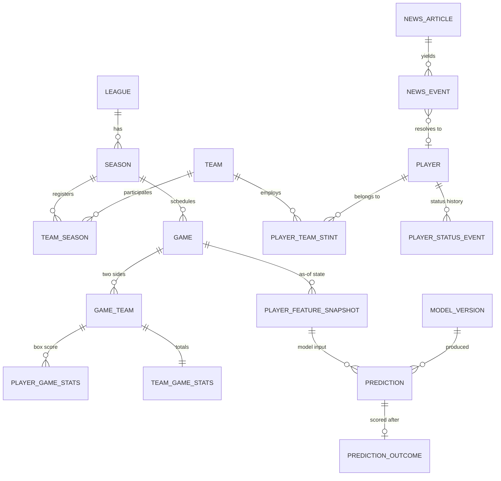

# Data model

The schema is **bitemporal**: it records both when a fact became true in the world and
when our system learned it. That is what makes the central question answerable —

> *What did the system know at 17:00 on the day of the game?*

Everything below follows from that requirement.

---

## 1. The three timestamps

Every table uses a consistent vocabulary. Mixing these up is the most likely source of a
silent leak, so the names are never abbreviated or reused for other purposes.

| Column | Question it answers | Used in features? |
|---|---|---|
| `event_timestamp`, `effective_from`, `effective_until`, `published_at`, `tip_off_utc` | **When was this true in the world?** | Only for ordering and windowing |
| `observed_at` | **When did we learn it?** | **Yes — this is the leakage filter** |
| `created_at`, `updated_at` | Row bookkeeping | Never |

### The rule

```sql
-- CORRECT: only facts we had actually recorded by as_of
WHERE observed_at <= :as_of

-- WRONG: leaks. A report published at 19:00 about a 10:00 injury
-- would be visible to a model predicting at 17:00.
WHERE event_timestamp <= :as_of
```

Both are usually applied together — `observed_at <= :as_of` for correctness and
`event_timestamp <= :as_of` for sanity — but `observed_at` is the one that must never be
omitted.

### Two storage patterns

**Interval rows** for state that changes: `[effective_from, effective_until)`, half-open,
`NULL` upper bound meaning "still open". Superseding a fact closes the old row and inserts
a new one. Old values are never overwritten.

**Append-only events** for point-in-time observations: availability changes, news,
lineup announcements. The `10:00 OUT → 14:00 QUESTIONABLE → 18:30 AVAILABLE` sequence is
three rows. "Status as of T" is a query, not a column. There is deliberately **no**
`players.current_status` column — if it existed, some feature would eventually read it.

---

## 2. Entity map



---

## 3. Identity and external references

Provider IDs never become primary keys. Every internal entity uses a UUID; the mapping to
provider identifiers lives in one table.

### `external_refs`

| Column | Type | Notes |
|---|---|---|
| `id` | UUID PK | |
| `provider_key` | text | `"euroleague"`, `"fixture"`, `"sportradar"` |
| `entity_type` | enum | `league`, `season`, `team`, `player`, `game` |
| `external_id` | text | Provider's identifier, normalised (trimmed, uppercased) |
| `internal_id` | UUID | The entity this maps to |
| `observed_at` | timestamptz | |

Unique on `(provider_key, entity_type, external_id)`; indexed on
`(entity_type, internal_id)`.

**Why a separate table rather than `euroleague_id` columns:** the same player appears in
EuroLeague, ACB, and a licensed feed under three different IDs. Columns would mean a new
migration per provider and a sparse, mostly-NULL table. This design also lets ingestion
resolve "have I seen this before?" through one uniform code path.

**A note on EuroLeague IDs.** The legacy boxscore endpoint returns space-padded person
codes (`"P007200   "`), while the v2 endpoint returns `"006590"`. Normalisation strips
whitespace and any leading `P`, then zero-pads to six digits, so both resolve to the same
entity.

---

## 4. Competition entities

### `leagues`
`id` · `code` (unique, e.g. `EUROLEAGUE`, `ABA`, `ACB`) · `name` · `country_code`
(nullable — EuroLeague is transnational) · `tier` · `created_at` · `updated_at`

Nothing here is EuroLeague-specific. Adding ACB is a row, not a migration.

### `seasons`
`id` · `league_id` FK · `code` (`E2025`) · `name` · `start_year` · `start_date` ·
`end_date` · timestamps. Unique `(league_id, code)`.

### `teams`
`id` · `code` · `name` · `short_name` · `country_code` · `city` · `venue_name` ·
`venue_latitude` / `venue_longitude` (nullable, for travel features) · timestamps.

Teams are **league-independent** — Real Madrid is one row that plays in both EuroLeague
and ACB. Participation is expressed by `team_seasons`.

### `team_seasons`
`id` · `team_id` · `season_id` · `display_name` (sponsored name, which changes yearly) ·
timestamps. Unique `(team_id, season_id)`.

Sponsorship changes ("Kosner Baskonia" vs "Baskonia") live here, not on `teams`, so a
name change never orphans historical stats.

---

## 5. People

### `players`
`id` · `full_name` · `last_name` · `first_name` · `birth_date` · `country_code` ·
`birth_country_code` · `height_cm` · `weight_kg` · `position` (enum
`GUARD`/`FORWARD`/`CENTER`/`UNKNOWN`) · timestamps.

Only genuinely immutable biographical attributes. Team, jersey number, and role are
**not** here — they change mid-season and belong in interval tables.

### `player_team_stints` — interval

| Column | Notes |
|---|---|
| `id`, `player_id`, `team_id`, `season_id` | |
| `jersey_number` | Changes with transfers |
| `position` | Club-declared position for this stint |
| `effective_from` | Stint start |
| `effective_until` | NULL while active |
| `is_active` | Provider's own active flag, retained for reconciliation |
| `observed_at` | When ingestion recorded this stint |

This is the transfer history. "Which team was this player on at time T?" is a query over
intervals, which means a January transfer does not retroactively rewrite December's
features. The EuroLeague `/people` endpoint supplies `startDate`/`endDate` directly, so
this maps cleanly.

### `coaches` and `team_coach_stints`
Same interval pattern. Coach changes are a real EuroLeague signal — rotations shift
sharply after a sacking — so the change date must be recoverable.

---

## 6. Games and box scores

### `games`

| Column | Notes |
|---|---|
| `id`, `season_id` | |
| `game_code` | Provider round-scoped code |
| `round_number`, `phase_code`, `group_name` | Competition structure |
| `tip_off_utc` | **Authoritative time.** All windowing uses UTC. |
| `tip_off_local`, `local_timezone` | Retained for travel/timezone features |
| `status` | `SCHEDULED` / `LIVE` / `FINISHED` / `POSTPONED` / `CANCELLED` |
| `is_neutral_venue`, `venue_name`, `attendance` | |
| `home_team_id`, `away_team_id` | Denormalised for query convenience |
| `home_score`, `away_score` | NULL until played |
| `observed_at` | |

Unique `(season_id, game_code)`. Indexed on `(season_id, tip_off_utc)` and
`(home_team_id, tip_off_utc)` / `(away_team_id, tip_off_utc)` — these back the rest/
schedule-density features and are the hottest queries in the system.

**Schedule changes are ordinary interval updates.** A postponed game gets a new
`tip_off_utc` and a fresh `observed_at`; the prior value remains in the row's history via
the ingestion audit, so a model predicting before the postponement is not retroactively
"corrected".

### `game_teams`
`id` · `game_id` · `team_id` · `side` (`HOME`/`AWAY`) · `score` · `quarter_scores`
(JSONB) · `coach_id`. Unique `(game_id, side)`.

The join target for box scores. Its existence means `player_game_stats` does not need to
carry both a game and a team foreign key with the risk of them disagreeing.

### `player_game_stats`

`id` · `game_team_id` · `player_id` · `seconds_played` · `is_starter` ·
`did_not_play` · then the counting stats:

`points` · `fg2m` · `fg2a` · `fg3m` · `fg3a` · `ftm` · `fta` · `offensive_rebounds` ·
`defensive_rebounds` · `total_rebounds` · `assists` · `steals` · `turnovers` ·
`blocks_favour` · `blocks_against` · `fouls_committed` · `fouls_received` · `valuation` ·
`plus_minus` · `observed_at`

Unique `(game_team_id, player_id)`.

Design notes:

- **`seconds_played`, not a minutes string.** The provider gives `timePlayed: 1850.0`
  (v2) or `"33:21"` (legacy). Storing seconds as an integer removes parsing ambiguity from
  every downstream consumer. Minutes are a presentation concern.
- **Two-point and three-point attempts stored separately.** Totals are derivable;
  splitting them is not. EuroLeague three-point rate is a first-class feature.
- **`did_not_play` is explicit.** `seconds_played = 0` is ambiguous between "did not
  dress" and "played 12 seconds". Minutes models need that distinction, since DNPs must
  usually be excluded from form averages rather than counted as zeros.
- **`valuation` is retained.** It is the standard European efficiency metric and a useful
  baseline target even though it is a linear combination of the others.

### `team_game_stats`
Same counting stats aggregated per team, plus `possessions` and `pace` (computed at
ingest from the standard estimator). Backs opponent-strength and pace features without
re-aggregating box scores on every feature build.

---

## 7. Availability and status

### `player_status_events` — append-only

| Column | Notes |
|---|---|
| `id`, `player_id`, `team_id` (nullable), `game_id` (nullable) | |
| `status` | `AVAILABLE` / `PROBABLE` / `QUESTIONABLE` / `DOUBTFUL` / `OUT` / `SUSPENDED` / `UNKNOWN` |
| `reason` | Free text |
| `injury_type` | Nullable, normalised where possible |
| `expected_return_date` | Nullable |
| `source_type` | `PROVIDER` / `NEWS` / `MANUAL` |
| `source_id` | FK to `news_articles` when derived from news |
| `confidence` | 0–1; NULL for authoritative provider data |
| `event_timestamp` | When the status changed |
| `observed_at` | When we learned it |

This table is the reason the schema exists in this shape. The worked example:

| # | `event_timestamp` | `status` | `observed_at` |
|---|---|---|---|
| 1 | 10:00 | `OUT` | 10:05 |
| 2 | 14:00 | `QUESTIONABLE` | 14:12 |
| 3 | 18:30 | `AVAILABLE` | 18:33 |

A model predicting at **17:00** sees rows 1 and 2, resolves to `QUESTIONABLE`, and
correctly does not know about the 18:30 upgrade. Had we stored a single mutable
`status` column, that prediction would be unreproducible — and any backtest of it
dishonest.

### `starting_lineups` — append-only
`id` · `game_id` · `team_id` · `player_id` · `is_confirmed` · `announced_at` ·
`observed_at`. Projected lineups arrive early and get superseded by confirmed ones; both
are kept. `is_confirmed = false` is a strong pre-game feature in EuroLeague, where
lineups leak via the press hours ahead.

---

## 8. News

### `news_sources`
`id` · `key` · `name` · `feed_url` · `language` · `is_enabled` · `reliability_weight`.

### `news_articles`
`id` · `source_id` · `external_id` · `url` (unique) · `title` · `summary` · `body` ·
`language` · `author` · `published_at` · `observed_at` · `content_hash`.

`content_hash` deduplicates syndicated copies of the same story. `published_at` is what
the publisher claims; `observed_at` is when we fetched it, and only the latter gates
features.

### `news_events` — the structured output
`id` · `article_id` · `event_type` · `player_id` (nullable) · `team_id` (nullable) ·
`payload` (JSONB) · `confidence` · `extraction_model` · `event_timestamp` · `observed_at`.

`event_type` enum: `INJURY`, `AVAILABILITY_CHANGE`, `MINUTES_LIMIT`, `ROLE_CHANGE`,
`STARTER_CHANGE`, `TRANSFER`, `COACH_COMMENT`, `ROTATION_CHANGE`, `RETURN_FROM_INJURY`,
`COACH_CHANGE`, `OTHER`.

The target transformation:

> *"Coach says Player X will have his minutes monitored tonight."*

```json
{
  "event_type": "MINUTES_LIMIT",
  "player_id": "…",
  "payload": {"expected_minutes": null, "quote_span": [12, 61]},
  "confidence": 0.91,
  "extraction_model": "…"
}
```

Extraction is **planned**; the tables exist now so that landing it is an insert path, not
a migration. Generic sentiment is explicitly out of scope — the signal is the basketball
event, not the tone.

---

## 9. Feature snapshots

### `player_feature_snapshots`

| Column | Notes |
|---|---|
| `id`, `player_id`, `game_id`, `team_id`, `opponent_team_id` | |
| `prediction_timestamp` | The `as_of` cutoff. **Defines what the row was allowed to see.** |
| `feature_set_version` | Which builder produced it |
| `features` | JSONB, `{feature_name: float\|null}` |
| `computed_at` | |

Unique `(player_id, game_id, feature_set_version, prediction_timestamp)`.

**Immutable.** A snapshot is written once and never updated. If the feature definitions
change, that is a new `feature_set_version` and new rows. This is what lets a prediction
made in October still be explained in April with the exact inputs it consumed, even if the
underlying box scores have since been corrected.

**Why JSONB rather than 200 columns.** Feature sets churn constantly during model
development; a migration per experiment would be unworkable. Volume is modest (roughly
`players × games` — tens of thousands of rows per season, not billions), so the query cost
is irrelevant. Names and dtypes are pinned by `feature_set_version` and validated on write.

### `team_feature_snapshots`
Same pattern, keyed `(team_id, game_id, feature_set_version, prediction_timestamp)`.

---

## 10. Predictions and model registry

### `model_versions`
`id` · `name` (`minutes_lgbm`) · `version` (semver) · `target` · `algorithm` ·
`feature_set_version` · `hyperparameters` (JSONB) · `training_data_hash` ·
`trained_at` · `artifact_path` · `metrics` (JSONB) · `is_active`.
Unique `(name, version)`.

`training_data_hash` makes training reproducible: it pins exactly which rows produced the
model.

### `predictions`
`id` · `model_version_id` · `player_feature_snapshot_id` · `player_id` · `game_id` ·
`target` · `predicted_value` · `predicted_std` (nullable) · `quantiles` (JSONB, nullable)
· `threshold_probabilities` (JSONB, nullable, e.g. `{"15": 0.72, "20": 0.43}`) ·
`explanation` (JSONB, nullable) · `prediction_timestamp` · `created_at`.

Unique `(model_version_id, player_id, game_id, target, prediction_timestamp)`.

Every prediction carries its model version, its timestamp, and a pointer to the exact
feature snapshot it used. Those three make it reproducible and explainable.

`explanation` holds signed contributions in the shape the product needs:

```json
{
  "drivers": [
    {"feature": "minutes_trend_5", "direction": "+", "contribution": 1.8,
     "label": "Increased projected minutes"},
    {"feature": "teammate_injury_count", "direction": "+", "contribution": 1.1,
     "label": "Increased usage due to teammate injury"},
    {"feature": "opponent_def_rating", "direction": "-", "contribution": -0.9,
     "label": "Tough opponent defense"}
  ]
}
```

### `prediction_outcomes`
`id` · `prediction_id` (unique) · `actual_value` · `absolute_error` ·
`squared_error` · `evaluated_at`.

Written by a post-game job. Model accuracy becomes a SQL query rather than a
recomputation, which is what makes continuous monitoring cheap.

---

## 11. Ingestion audit

### `ingestion_runs`
`id` · `job_name` · `provider_key` · `season_code` · `status`
(`RUNNING`/`SUCCEEDED`/`FAILED`) · `started_at` · `finished_at` · `rows_read` ·
`rows_written` · `error_message` · `details` (JSONB).

A failed overnight backfill should be diagnosable from a table, not from log archaeology.

---

## 12. Invariants

These hold by constraint where a constraint is possible, and by test where it is not.

1. No mutable domain fact is overwritten. Corrections close an interval or append an
   event.
2. `observed_at` is non-null on every ingested row and defaults to the ingestion clock,
   never to `now()` at query time.
3. `effective_until IS NULL OR effective_until > effective_from`.
4. Exactly two `game_teams` per game, one `HOME` and one `AWAY`.
5. `player_game_stats` exists only for games with `status = FINISHED`.
6. Feature snapshots are immutable after insert.
7. Every prediction references a feature snapshot whose `prediction_timestamp` equals the
   prediction's.
8. A feature snapshot never contains information from a row with
   `observed_at > prediction_timestamp`. **This is the leakage invariant** and is asserted
   directly by `tests/integration/test_no_leakage.py`.

---

## 13. Conventions

- **UUID primary keys**, generated application-side so ingestion can build object graphs
  before flushing.
- **`timestamptz` everywhere**, always UTC. Local time is stored separately and only for
  features that genuinely need it (travel, timezone shift).
- **Enums as Postgres native types**, so bad values fail at the database rather than
  surfacing as a mysterious model input three weeks later.
- **JSONB only for genuinely schemaless payloads**: feature vectors, hyperparameters,
  quarter scores, extraction payloads. Never for anything that will be filtered or joined
  on.
- **No `ON DELETE CASCADE` on historical tables.** Losing history to a stray delete is
  precisely the failure this schema exists to prevent.
